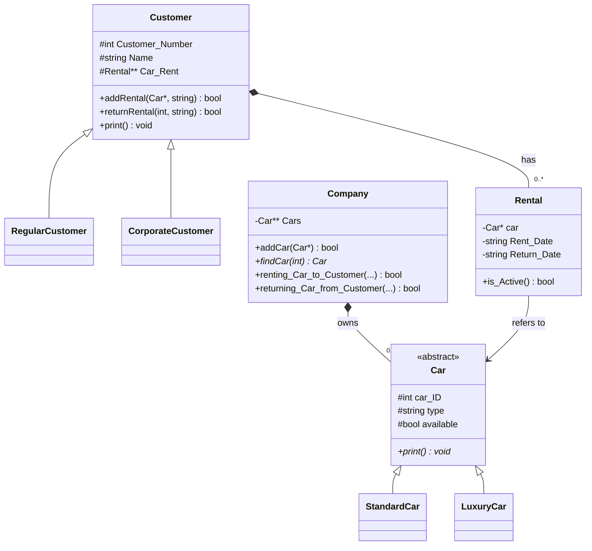

# Car Dealership System (CoenCars)


A C++ console application for a car rental company, built to practise
object-oriented programming: inheritance, polymorphism, abstract classes and manual
dynamic memory management.

- **Question 1** creates Standard and Luxury cars through `Car*` pointers and prints
  them with dynamic binding.
- **Question 2** is an interactive menu to add cars and customers, rent and return
  cars, and list all, available or rented cars.

## Class Design



| Class | Role |
|---|---|
| `Car` | Abstract base class with a pure virtual `print()` |
| `StandardCar`, `LuxuryCar` | Concrete cars that override `print()` |
| `Company` | Owns up to 1000 cars, handles renting and returning |
| `Customer` | Base customer with a growable array of rentals |
| `RegularCustomer`, `CorporateCustomer` | Customer types with their own `print()` |
| `Rental` | Links a customer to a car with rent and return dates |

## Project Structure

```
Car_dealership_system/
├── include/            # Class declarations (.h)
├── src/                # Class implementations (.cpp) and the two drivers
│   ├── Question1_driver.cpp
│   └── Question2_driver.cpp
├── CMakeLists.txt
└── README.md
```

## Build and Run

Requires CMake 3.20+ and a C++20 compiler (GCC, Clang or MSVC).

```bash
cmake -S . -B build
cmake --build build

./build/Question1     # polymorphism demo
./build/Question2     # interactive rental menu
```

On Windows the programs are `build\Question1.exe` and `build\Question2.exe`.
In CLion, open the `Car_dealership_system` folder and pick `Question1` or `Question2`
from the run configurations.

## Example (Question 2)

```
========== MENU ==========
1) Add Standard Car
...
5) Rent Car to Customer
6) Return Car from Customer
...
11) Exit
Choose: 5
Enter Customer Number: 1
Enter Car ID to rent: 1001
Enter Rent Date (e.g., 2026-01-01): 2026-01-01
Rent successful! Car is now UNAVAILABLE.
```

## Authors
Rad Mahmoudi

## License
This project is licensed under the MIT License. See [LICENSE](LICENSE) for details.